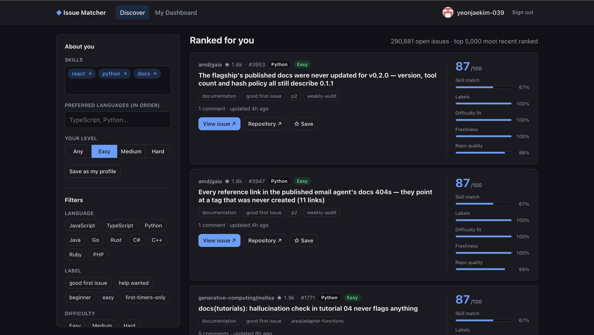
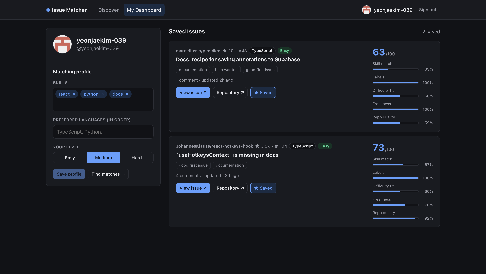
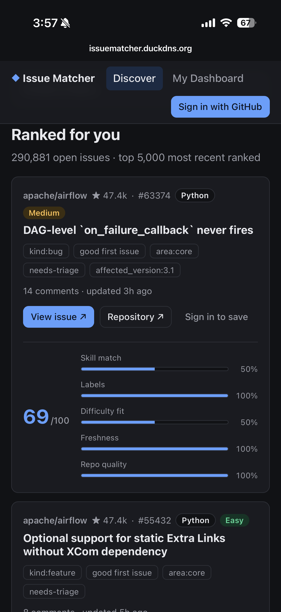
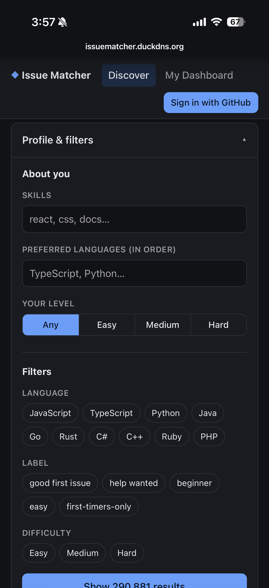
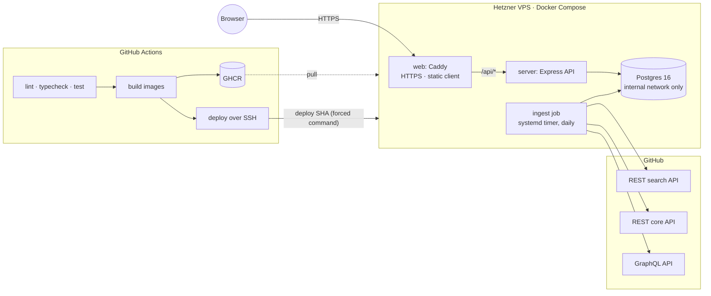

# GitHub Issue Matcher

**Find a good first open-source issue that actually fits you.** Tell it your skills, languages and
level; it ranks hundreds of thousands of beginner-friendly GitHub issues and explains every score.

**Live demo → [issuematcher.duckdns.org](https://issuematcher.duckdns.org)**

[](https://github.com/yeonjaekim-039/Github-issue-matcher/actions/workflows/ci.yml)

| | |
|---|---|
| Open issues indexed | **362,852** across **122,039** repositories |
| Served after filtering (unassigned, repo not archived) | **290,881** |
| Labels crawled | `good first issue` (224,709) · `help wanted` (178,763) · `easy` (10,349) · `beginner` (2,697) · `first-timers-only` (573) |
| Difficulty mix | 216,443 easy · 121,266 medium · 25,143 hard |
| Tests | 186 (149 server, 37 client), run on every push |

<sub>Production database, November 6, 2026. Refreshed daily.</sub>

---

## Screenshots

**Discover:** your profile and filters on the left, ranked issues with a five-part score breakdown on the right.



**My Dashboard:** saved issues, re-scored against your saved matching profile.



**Mobile:** results stack in a single column with the score below each card; filters fold into a "Profile & filters" panel.

<p>
  
  &nbsp;
  
</p>

---

## Features

- **Personalized ranking.** Enter skills (`react`, `css`, `django`…), preferred languages in order, and your level.
  Every result shows its 0–100 score and a five-part breakdown, so the ranking is never a black box.
- **Filters.** Language, label and difficulty, combinable, applied in SQL before ranking.
- **Shareable searches.** All Discover state lives in the URL, so a search is a link and back/forward just works.
- **Sign in with GitHub.** OAuth with no scopes (public profile only). Your profile is saved and pre-fills the
  form, and you can bookmark issues to **My Dashboard**, which re-scores them against your current profile and
  tells you how many you saved have since been closed.
- **Fresh data.** A daily ingest crawls GitHub, detects issues that were closed, transferred or relabeled, and
  refreshes repository stars, activity and archived status.
- **Responsive, light and dark.** Single-column layout under 900px with a collapsible filter panel; follows the system theme.

---

## How ranking works

Ranking is a pure, unit-tested function ([`server/src/domain/scoring.ts`](server/src/domain/scoring.ts)) with no I/O;
the current time is passed in, so tests are deterministic. Each component is a number from 0 to 1; the score is the
weighted sum × 100.

| Component | Weight | How it's computed |
|---|---:|---|
| **Match** | 0.38 | 60% language preference (1st choice = 1.0, each later choice −0.1, floor 0.6, others 0) + 40% skill match: the share of your skills (up to 3) found as whole tokens in the title, labels, repo name and language. `go` doesn't match "going"; `c++`, `c#` and `node.js` stay intact. |
| **Difficulty fit** | 0.24 | Issue difficulty vs. your level. Exact = 1.0. One step *easier* = 0.6, two = 0.2. One step *harder* = 0.3, two = 0. Too hard is penalized more than too easy. |
| **Labels** | 0.19 | `good first issue` / `first-timers-only` 1.0, `beginner` 0.9, `easy` 0.85, `help wanted` 0.6, none 0.2. A label you asked for scores 1.0. |
| **Freshness** | 0.14 | Exponential decay on last update, 45-day half-life. |
| **Repo quality** | 0.05 | 60% stars, log-scaled and saturating at 10k (100 stars = 0.5), plus 40% last push (90-day half-life). Deliberately small: a tie-breaker, not a popularity contest. |

Anything you leave blank, and any repo whose metadata hasn't been fetched yet, scores a **neutral 0.5**
rather than 0, so missing data neither buries nor boosts an issue. Ties break on most recently updated.

**Assigned issues are dropped**, and so are issues in **archived repositories**. The crawler skips repos
already known to be archived, and every query (search, saved issues, the closed-issue sweep) filters them out.

### Repo diversity

A large project with hundreds of beginner issues would otherwise fill page one. After ranking, at most
**2 issues per repo per page** are shown. Extras are **moved to later pages, never dropped**. The
arrangement is computed over the whole ranked list for the requested page size, so page boundaries are stable
as you paginate ([`diversity.ts`](server/src/domain/diversity.ts)).

### Difficulty heuristic

GitHub has no difficulty field, so ingest estimates one ([`difficulty.ts`](server/src/ingest/difficulty.ts)).
It starts from 0 and adds signals:

| Signal | Effect |
|---|---|
| Label contains `hard` / `complex` / `advanced` / `expert` | +3 (or `medium` / `intermediate` +1.5) |
| `first-timers-only` / other easy labels (`good first issue`, `beginner`, `easy`, `starter`, `typo`…) | −3 / −2 |
| `documentation` / `docs` · `help wanted` | −0.5 · +0.5 |
| More than 10 comments / more than 4 | +1.5 / +0.5 |
| Body over 3,000 chars / over 1,200 / under 300 | +1.5 / +0.5 / −0.5 |

A score of −1 or below is **easy**, below 1.5 is **medium**, anything higher is **hard**. Long discussions and long
specs usually mean a harder task.

### The 5,000-candidate cap

Filters run in Postgres, which then hands the **5,000 most recently updated** matching rows to the ranker. That
keeps every request fast, at the cost of never surfacing an older issue when a filter matches more than 5,000.
The API reports both numbers (`total` matched vs. `rankedCount` actually ranked), so the cut-off is visible.

---

## Architecture



### Client: React + Vite

React 19 with react-router. All Discover state (skills, languages, level, filters, page) is read from and written to
the URL. A `SessionProvider` holds the signed-in user and saved issue ids, with optimistic save/unsave. Filter
options come from `GET /api/meta`, so the list of crawled languages and labels has one source of truth on the server.
Plain CSS with light/dark tokens.

### API: Express 5 + TypeScript

`GET /api/issues` validates its query with Zod, filters in SQL, ranks in JS, applies repo diversity, then paginates.
Stores (`IssueStore`, `UserStore`, `SavedStore`) and the OAuth client are injected into `createApp(deps)`, so route
tests run against in-memory fakes, and **CI needs no database**. Sessions are a stateless HMAC-signed, httpOnly,
SameSite=Lax cookie; nothing is stored server-side.

### Database: Postgres 16

Plain-SQL migrations applied in order and tracked in `schema_migrations`. Issues are keyed by GitHub id; labels are a
`TEXT[]` with a GIN index for label filters. Issue state is `open`, `closed` or `delisted`, and only `open` is ever served.

### Ingest pipeline

Runs in three phases: **crawl → repo metadata → closed-issue sweep**.

- **Crawl.** One GitHub search query per (label, language). GitHub returns at most **1,000 results per query** no
  matter how you paginate, so any query over the cap is **split recursively by `created:` date range** until every
  window fits. Pages are de-duplicated and upserted in one multi-row `INSERT … ON CONFLICT` per page.
- **Rate limiting.** Requests are spaced to stay under the search limit (2.1 s apart with a token), and the client
  waits out `x-ratelimit-reset` / `retry-after` and retries on 403/429/5xx.
- **Repo metadata over GraphQL.** Stars, last push and archived status are cached per repo, fetched with **50 aliased
  `repository()` lookups per GraphQL request**. Refreshing ~120k repos takes about an hour instead of the days that
  one REST call per repo would need under the rate limit. Metadata older than 7 days is refetched; deleted repos are
  marked archived.
- **Closed-issue sweep.** Search only returns open issues, so an issue that disappears from results can't be told
  apart from one that merely fell outside a window. After a full crawl, every open issue that wasn't seen is
  re-fetched individually and marked **closed** (closed, deleted, transferred), **delisted** (still open but no
  longer has a target label) or refreshed. The decision logic is a pure `reconcile()` function with unit tests.

### Production and CI/CD

- **Docker Compose** project with three services. **Postgres sits on an `internal: true` network** with no published
  port and no internet access. Only the `web` container binds 80/443. The VPS also hosts an unrelated project, which
  the stack is isolated from by project name, networks, volumes and labels.
- **Caddy** terminates TLS with automatic Let's Encrypt certificates, serves the built client with immutable caching
  for hashed assets and an SPA fallback, adds HSTS and other security headers, and proxies `/api/*` to Express.
- **GitHub Actions**: every push runs lint, typecheck and tests for both packages. On `main`, it then builds both
  images, pushes them to **GHCR** tagged with the commit SHA, and deploys.
- **Restricted deploy key.** The CI key can't open a shell. In `authorized_keys` it is pinned with `restrict` and a
  forced command ([`deploy/deploy-gate.sh`](deploy/deploy-gate.sh)) that accepts only `deploy <40-char commit SHA>`,
  downloads that commit's deploy files from this public repo itself, and runs
  [`deploy.sh`](deploy/deploy.sh). It refuses any other command, file upload or port forwarding, and logs every refusal.
- **Health-checked deploys with rollback.** `deploy.sh` pulls the new tag first, so a bad tag fails before anything
  restarts. It then waits for the API health check and rolls back to the previous tag if the check fails.
- **Daily ingest** runs from a systemd timer, with a `flock` so runs never overlap. Secrets live only in a
  root-only `.env` on the server.

---

## Tech stack

| | |
|---|---|
| **Client** | React 19, TypeScript, Vite 8, react-router 8, plain CSS · oxlint · Vitest + Testing Library (jsdom) |
| **Server** | Node 24, Express 5, TypeScript (ESM), Zod 4, node-postgres · ESLint · Vitest + Supertest |
| **Data** | PostgreSQL 16, GitHub REST search + core APIs, GitHub GraphQL API |
| **Infra** | Docker (multi-stage builds), Docker Compose, Caddy 2, GHCR, GitHub Actions, systemd, Hetzner Cloud |

---

## Local setup

Requires Node 24+, Docker, and a [GitHub personal access token](https://github.com/settings/tokens) (no scopes needed).

```sh
git clone https://github.com/yeonjaekim-039/Github-issue-matcher.git
cd Github-issue-matcher
cp .env.example .env            # set GITHUB_TOKEN
docker compose up -d            # Postgres on host port 5433

cd server
npm install
npm run migrate
npm run ingest -- --languages=TypeScript --max-issues=2000   # a quick sample; omit flags for a full crawl
npm run dev                     # API on http://localhost:3001

cd ../client
npm install
npm run dev                     # http://localhost:5173 (proxies /api to :3001)
```

**Optional: GitHub login.** Create a GitHub OAuth App with the callback URL
`http://localhost:5173/api/auth/github/callback`, then set `GITHUB_CLIENT_ID`, `GITHUB_CLIENT_SECRET`,
`SESSION_SECRET` (any long random string) and `CLIENT_URL=http://localhost:5173` in `.env`. Without these the app runs
signed-out only.

Useful ingest flags: `--labels="good first issue"`, `--recheck-only` (just the closed-issue sweep),
`--repo-meta-only`, `--no-repo-meta`, `--max-rechecks=N`.

### API example

```
GET /api/issues?skills=react,css&preferredLanguages=TypeScript,JavaScript&level=easy&difficulty=easy&page=1&pageSize=20
```

The response includes `total`, `rankedCount`, `totalPages`, the effective `profile`, and `items[]`, each with its
`score` and `breakdown`. See [CLAUDE.md](CLAUDE.md) for every parameter.

## Running tests

```sh
cd server && npm run lint && npm run typecheck && npm test
cd client && npm run lint && npm run typecheck && npm test
```

Tests need no database or network: scoring, difficulty, diversity, query splitting, GraphQL batching and sweep
reconciliation are pure functions, and routes are tested against in-memory stores and a fake OAuth client. CI runs
the same commands for both packages on every push and pull request.

---

## Known limitations

- **Language coverage is still filling in.** The index targets 10 languages. Python, TypeScript, JavaScript, Java and
  Go are crawled; Rust, C#, C++, Ruby and PHP are being backfilled by the daily ingest.
- **"Language" is the queried language, not the repo's.** Search results don't include a repo's language, so an issue
  is tagged with the language filter that found it.
- **Skill matching is lexical.** It looks for whole-token matches in titles, labels and repo names. It doesn't read
  issue bodies and doesn't know that `nextjs` implies `react`.
- **Difficulty is a heuristic.** It's a reasonable guess from labels, comment count and length, not a judgment of the
  actual work.
- **Only the 5,000 most recently updated matches are ranked.** Broad searches never surface older issues.
- **"Unassigned" isn't "unclaimed."** Someone may have said "I'll take this" in a comment without being assigned.
- **Data is up to a day old.** A closed issue can stay listed until the next sweep, which re-checks up to 3,000 issues
  per run and carries the rest over.
- **Single server.** One VPS, no replica or automated off-site backup. Sessions are stateless, so signing out
  everywhere means rotating `SESSION_SECRET`.
